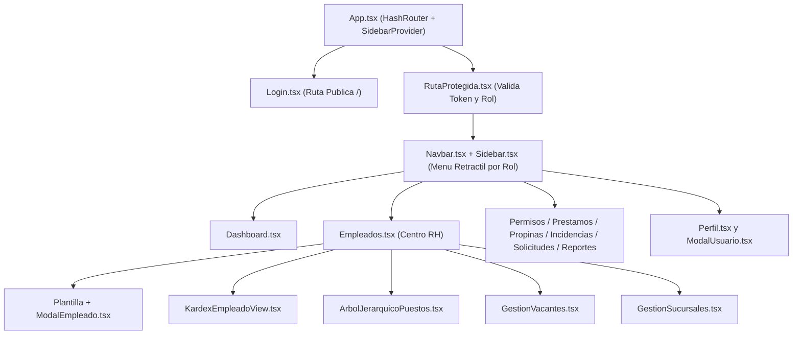

# Documentación Técnica del Frontend — PADRÓN RH

Este documento describe la arquitectura, componentes, sistema de diseño, capa de servicios HTTP/IPC, control de permisos por rol y empaquetado Electron de la interfaz gráfica de **PADRÓN — Recursos Humanos y Operación**.

---

## 1. Stack Tecnológico y Arquitectura

| Capa | Tecnología | Propósito |
| :--- | :--- | :--- |
| **Librería UI** | React 19 + TypeScript | Renderizado declarativo con tipado estático estricto. |
| **Bundler** | Vite 8 | Compilación rápida y empaquetado con rutas relativas (`base: './'`) compatibles con `file://`. |
| **Estilos y Diseño** | Tailwind CSS v4 | Utilidades CSS modernas y sistema de diseño institucional sin estilos inline innecesarios. |
| **Enrutamiento** | React Router DOM v7 (`HashRouter`) | Navegación SPA compatible tanto con servidor web de desarrollo como con carga local en Electron. |
| **Runtime de Escritorio** | Electron 44 (`main.cjs` + `preload.cjs`) | Contenedor nativo de escritorio que orquesta el proceso del backend en Go (`padron.exe`) y SQLite. |
| **Empaquetador** | `electron-builder` 26 | Generación de ejecutable autónomo (`PADRON RH Portable.exe`) e instalador Windows NSIS (`PADRON RH Setup 1.0.0.exe`). |



---

## 2. Estructura de Directorios del Frontend

```text
frontend/
├── electron/
│   ├── main.cjs                       # Proceso principal de Electron: inicia padron.exe, gestiona BD y ventana
│   ├── preload.cjs                    # ContextBridge seguro: expone window.padron (getBaseUrl, getApiUrl)
│   ├── icon.ico                       # Ícono multirresolución de la marca PADRÓN para Windows
│   └── icon.png                       # Ícono en formato PNG
├── public/
│   ├── logo.jpg                       # Logotipo oficial de Carnitas y Carne Asada PADRÓN
│   ├── icon.ico                       # Ícono público
│   └── icon.png
├── recursos/
│   ├── padron.exe                     # Binario compilado del backend Go embebido en el empaquetado
│   ├── padron.db                      # Base de datos SQLite semilla para instalaciones limpias
│   └── icon.ico
├── src/
│   ├── assets/
│   │   ├── logo.jpg                   # Activo gráfico del logotipo
│   │   └── logo.ts                    # Exportación centralizada del logo para componentes
│   ├── components/
│   │   ├── ui/                        # Design System propio (componentes atómicos reutilizables)
│   │   │   ├── Badge.tsx              # Etiquetas de estado semánticas (success, warning, danger, info, default)
│   │   │   ├── Button.tsx             # Botones con variantes (primary, secondary, danger, ghost, outline)
│   │   │   ├── EmptyState.tsx         # Estado vacío estandarizado con icono y acción opcional
│   │   │   ├── Icons.tsx              # Catálogo de íconos vectoriales SVG limpios (cero emojis)
│   │   │   ├── Input.tsx              # Campo de entrada con etiqueta, validación y estado bloqueado
│   │   │   ├── LoadingState.tsx       # Indicador de carga animado
│   │   │   ├── Modal.tsx              # Ventana emergente con fondo acrílico (backdrop-blur) y cierre por ESC
│   │   │   ├── Select.tsx             # Selector desplegable estilizado
│   │   │   └── index.ts               # Barril de exportación de componentes UI
│   │   ├── ArbolJerarquicoPuestos.tsx # Visualizador interactivo de jerarquía de puestos (no imprimible)
│   │   ├── Card.tsx                   # Contenedor de tarjetas de resumen
│   │   ├── GestionSucursales.tsx      # CRUD y activación/desactivación de sucursales
│   │   ├── GestionVacantes.tsx        # Administración de plazas, estados, asignación y liberación
│   │   ├── KardexEmpleadoView.tsx     # Expediente integral del trabajador con campos bloqueados y editables
│   │   ├── ModalEmpleado.tsx          # Formulario modal de alta/edición de empleados con selector de vacante
│   │   ├── ModalUsuario.tsx           # Modal de perfil rápido y cambio de contraseña (sin carga de archivos)
│   │   ├── Navbar.tsx                 # Barra superior con botón hamburguesa, migas de pan y acceso a perfil
│   │   ├── RutaProtegida.tsx          # Guardián de rutas por sesión activa y validación de roles permitidos
│   │   └── Sidebar.tsx                # Menú lateral retráctil filtrado dinámicamente según el rol del usuario
│   ├── context/
│   │   └── SidebarContext.tsx         # Estado global de apertura/colapso del menú hamburguesa
│   ├── pages/
│   │   ├── Login.tsx                  # Pantalla de acceso institucional conectada a AutenticacionService
│   │   ├── Dashboard.tsx              # Panel principal adaptado al rol (métricas operativas y accesos rápidos)
│   │   ├── Empleados.tsx              # Centro de Recursos Humanos (Personal, Kardex, Árbol, Vacantes, Sucursales)
│   │   ├── Permisos.tsx               # Gestión de ausencias, confirmación de suplencias y dictamen por jefes
│   │   ├── Prestamos.tsx              # Solicitud de préstamos, autorización y registro de retenciones semanales
│   │   ├── Propinas.tsx               # Apertura de bolsas diarias y cálculo ponderado por factor de puesto
│   │   ├── Incidencias.tsx            # Consulta y registro en la bitácora histórica inmutable
│   │   ├── Solicitudes.tsx            # Buzón interno de quejas, sugerencias e incidentes (anónimo o directo)
│   │   ├── Reportes.tsx               # Reportes ejecutivos de ausentismo, rotación por puesto y nómina
│   │   └── Perfil.tsx                 # Vista dedicada de identidad del usuario, jefe directo y seguridad
│   ├── services/
│   │   └── api.ts                     # Cliente HTTP tipado, manejo de sesión y todos los servicios del dominio
│   ├── App.tsx                        # Definición de rutas con HashRouter y protección por rol
│   ├── index.css                      # Configuración de Tailwind CSS y variables tipográficas/cromáticas
│   └── main.tsx                       # Punto de entrada de React DOM
├── package.json                       # Scripts de construcción y configuración de electron-builder
├── tsconfig.app.json                  # Configuración del compilador TypeScript
└── vite.config.ts                     # Configuración de Vite y proxy de desarrollo hacia Go (:8080)
```

---

## 3. Sistema de Diseño y Directrices Visuales

La interfaz sigue una estética limpia, cálida y legible inspirada en la identidad gráfica de **Carnitas y Carne Asada PADRÓN**:

1. **Paleta Cromática Institucional:**
   - **Superficie base:** Crema cálido (`#faf7f2`) y paneles blancos (`#ffffff`) con bordes de piedra sutiles (`border-stone-200/90`).
   - **Acentos de marca:** Ámbar profundo y terracota (`amber-700`, `amber-800`, `amber-950`) combinados con tipografía en tonos carbón (`stone-900`, `stone-600`).
   - **Semántica de estados:** Esmeralda para aprobaciones/activos (`emerald`), ámbar para pendientes (`amber`), rojo/rosa para rechazos o puestos críticos (`rose`/`red`).
2. **Cero Emojis:**
   - Todos los indicadores visuales utilizan exclusivamente vectores SVG definidos en [`src/components/ui/Icons.tsx`](src/components/ui/Icons.tsx) (`IconLock`, `IconUser`, `IconBriefcase`, `IconBuilding`, `IconTree`, `IconCheck`, `IconAlertTriangle`, etc.).
3. **Navegación Retráctil y Adaptativa:**
   - Menú tipo **hamburguesa** controlado por [`SidebarContext.tsx`](src/context/SidebarContext.tsx), que permite retraer o expandir la barra lateral.
   - Los módulos para los que el usuario no tiene permiso según su rol **no se renderizan en el menú** ni son accesibles por URL gracias a [`RutaProtegida.tsx`](src/components/RutaProtegida.tsx).
4. **Ventanas Emergentes (Modales):**
   - Todas las acciones de alta, dictamen de permisos, registro de incidencias, préstamos y edición se ejecutan mediante pop-ups modales (`Modal.tsx`) con fondo difuminado (`backdrop-blur`), evitando saturar la pantalla principal con formularios estáticos.

---

## 4. Descripción Detallada de Vistas y Módulos

### 4.1. Autenticación (`Login.tsx`)
- Presenta el logotipo oficial de PADRÓN, campos de usuario y contraseña, manejo de estados de carga y alertas claras de error devueltas por la API.
- Al iniciar sesión exitosamente, almacena el token Bearer y el rol en `sessionStorage`, registra la marca de tiempo `ultimoAcceso` en `localStorage` y redirige a `/dashboard`.

### 4.2. Panel Principal (`Dashboard.tsx`)
- Muestra indicadores en tiempo real según el nivel de acceso:
  - Para `RH_ADMIN` y `ENCARGADO`: Total de colaboradores activos, vacantes disponibles, solicitudes de permiso pendientes, préstamos activos y accesos directos a cada módulo.
  - Para `OPERATIVO`: Resumen de sus próximos turnos programados, estado de sus solicitudes de permiso, saldo de préstamos y propinas recientes.

### 4.3. Módulo Integral de Recursos Humanos (`Empleados.tsx`)
Organizado en **5 pestañas especializadas** para la administración del capital humano y la estructura de la empresa:

1. **Plantilla de Personal:**
   - Listado filtrable por sucursal, puesto, estado (activos/bajas) y buscador por nombre, CURP o número de nómina.
   - Alta de nuevos colaboradores mediante [`ModalEmpleado.tsx`](src/components/ModalEmpleado.tsx), permitiendo seleccionar una **Vacante disponible** (lo que asigna automáticamente el puesto y la sucursal correspondientes) y crear opcionalmente sus credenciales de usuario en un solo paso.
2. **Kardex de Usuario ([`KardexEmpleadoView.tsx`](src/components/KardexEmpleadoView.tsx)):**
   - Permite seleccionar a cualquier trabajador y visualizar su expediente completo, antigüedad en días, saldo pendiente de préstamos y contadores históricos.
   - **Campos bloqueados (modo sólo lectura con icono de candado):**
     - Nombre completo (`nombres`, `apellido_paterno`, `apellido_materno`)
     - CURP (`curp`)
     - Número de nómina (`numero_empleado`)
     - Fecha de ingreso (`fecha_ingreso`)
     - Usuario de acceso (`nombre_usuario`)
   - **Campos modificables por RH:** Puesto, Sucursal, Vacante/Plaza asignada, Sueldo base semanal, Teléfono, Correo electrónico y Estatus (Activo / Baja lógica).
   - **Pestañas de historial del trabajador:** Bitácora de incidencias, historial de permisos/coberturas y estado de cuenta de préstamos.
3. **Organigrama por Vacante Ocupada ([`ArbolJerarquicoPuestos.tsx`](src/components/ArbolJerarquicoPuestos.tsx)):**
   - Vista **100% informativa** (sólo lectura) que construye el organigrama exclusivamente a partir de las **vacantes ocupadas (`estado === 'CUBIERTA'`)** conectadas según la jerarquía del puesto asociado (`jefe_puesto_id`).
   - Cada nodo presenta el código de vacante, título de la plaza, puesto, sucursal y el colaborador titular asignado con su número de nómina.
   - Incluye filtro por sucursal y control de escala/zoom (`75%` a `115%`).
4. **Vacantes y Plazas ([`GestionVacantes.tsx`](src/components/GestionVacantes.tsx)):**
   - Catálogo de plazas operativas con filtros por estado (`DISPONIBLE`, `CUBIERTA`, `PAUSADA`, `CANCELADA`), sucursal y puesto.
   - Permite dar de alta nuevos puestos (`Nuevo Puesto`) y abrir nuevas vacantes con código único (ej. `VAC-008`), sueldo ofertado y requisitos; asignar una plaza disponible a un colaborador activo; o liberar una plaza ocupada.
5. **Sucursales ([`GestionSucursales.tsx`](src/components/GestionSucursales.tsx)):**
   - Alta y edición de sucursales específicas con nombre, dirección física, teléfono de contacto y activación/desactivación operativa.

### 4.4. Permisos, Ausencias y Suplencias (`Permisos.tsx`)
- **Separación de responsabilidades:**
  - Los colaboradores solicitan permisos (Vacaciones, Enfermedad, Descanso, Permiso Extraordinario) en un modal interactivo.
  - Si el trabajador ocupa un **puesto crítico** y las fechas incluyen sábado o domingo, el formulario exige seleccionar un compañero suplente activo del mismo puesto y sucursal.
  - El suplente visualiza la petición y confirma o rechaza la cobertura (`POST /cobertura/confirmar`).
  - Los **Jefes Directos / Encargados (`ENCARGADO`)** son quienes autorizan o rechazan las solicitudes operativas, mientras que RH mantiene un rol administrativo de consulta y registro.

### 4.5. Préstamos y Retenciones (`Prestamos.tsx`)
- Solicitud de préstamos en pop-up validando las reglas financieras (máximo 2 semanas de sueldo, abono semanal máximo del 35% del sueldo).
- Autorización/rechazo y registro de descuentos semanales en nómina (validando que la fecha de corte corresponda a un día **lunes**).

### 4.6. Bolsas de Propinas (`Propinas.tsx`)
- Registro de bolsas diarias por sucursal y ejecución del cálculo automático de reparto proporcional a `horas_trabajadas × factor_propina`.

### 4.7. Bitácora de Incidencias (`Incidencias.tsx`)
- Consulta filtrable por empleado y registro manual de eventos (`RETARDO`, `FALTA_JUSTIFICADA`, `FALTA_INJUSTIFICADA`, `ASISTENCIA_DIA_PICO`, etc.) mediante ventana modal.
- Respeta la inmutabilidad del backend: no ofrece botones de edición ni borrado sobre registros históricos.

### 4.8. Buzón Interno (`Solicitudes.tsx`) y Reportes (`Reportes.tsx`)
- **Buzón:** Envío de quejas, sugerencias o incidentes de seguridad/mantenimiento de forma directa o **anónima**, y seguimiento de respuestas.
- **Reportes Ejecutivos:** Consultas tabulares de Ausentismo por rango de fechas, Rotación histórica por puesto y Retenciones de nómina por semana.

### 4.9. Perfil de Usuario (`Perfil.tsx` y `ModalUsuario.tsx`)
- Muestra la identidad del usuario conectado, su rol, puesto, sucursal, **jefe directo** y fecha de último acceso, además del formulario de actualización de contraseña.
- **Sin carga de imágenes ni archivos:** Se eliminó por completo cualquier subida de fotografías o documentos adjuntos por perfil.

---

## 5. Capa de Servicios HTTP e Integración con la API (`src/services/api.ts`)

El archivo [`frontend/src/services/api.ts`](src/services/api.ts) centraliza toda la comunicación con el backend en Go:

### 5.1. Resolución Dinámica de la URL Base
```ts
export function getBaseApiUrl(): string {
  // 1. Si corre dentro de Electron, obtiene el puerto dinámico asignado al proceso hijo Go
  if (typeof window !== 'undefined' && (window as any).padron?.getApiUrl) {
    const api = (window as any).padron.getApiUrl();
    if (api) return api.replace(/\/$/, '');
  }
  // 2. Variable de entorno opcional
  if (import.meta.env.VITE_API_BASE_URL) {
    return import.meta.env.VITE_API_BASE_URL.replace(/\/$/, '');
  }
  // 3. Fallback a proxy local de Vite (/api/v1 -> http://127.0.0.1:8080/api/v1)
  return '/api/v1';
}
```

### 5.2. Servicios Exportados
- `AutenticacionService`: `iniciarSesion()`, `verificarSalud()`
- `PerfilService`: `obtenerPerfil()`, `cambiarContrasena()`
- `CatalogosService`: `listarSucursales()`, `crearSucursal()`, `actualizarSucursal()`, `listarPuestos()`, `crearPuesto()`, `actualizarPuesto()`
- `VacantesService`: `listar()`, `crear()`, `actualizar()`, `asignar()`, `liberar()`
- `EmpleadosService`: `listar()`, `obtenerPorId()`, `obtenerKardex()`, `crear()`, `actualizar()`
- `UsuariosService`: `listar()`, `crear()`, `actualizar()`
- `TurnosService`: `misTurnos()`, `listar()`, `crear()`, `actualizar()`
- `PermisosService`: `misSolicitudes()`, `listarTodas()`, `crear()`, `cancelar()`, `confirmarCobertura()`, `aprobar()`, `rechazar()`
- `PrestamosService`: `misPrestamos()`, `listarTodos()`, `solicitar()`, `aprobar()`, `rechazar()`, `registrarRetencion()`
- `PropinasService`: `misPropinas()`, `listarBolsas()`, `crearBolsa()`, `calcularAsignaciones()`
- `BuzonService`: `misReportes()`, `listarTodos()`, `enviar()`, `atender()`
- `IncidenciasService`: `listar()`, `registrar()`
- `ReportesService`: `ausentismo()`, `rotacionPorPuesto()`, `retencionesNomina()`

---

## 6. Arquitectura del Contenedor Electron y Empaquetado

### 6.1. Proceso Principal (`frontend/electron/main.cjs`)
1. **Apariencia Nativa:**
   - Desactiva por completo el menú predeterminado de Chromium/Electron (`Menu.setApplicationMenu(null)` y `autoHideMenuBar: true`).
   - Configura el ícono institucional `electron/icon.ico`, color de fondo `#faf7f2` y apertura limpia mediante el evento `ready-to-show` (sin parpadeo en blanco).
   - Deshabilita las herramientas de desarrollo (`devTools: !app.isPackaged`) en el ejecutable de producción.
2. **Bloqueo de Instancia Única:**
   - Usa `app.requestSingleInstanceLock()` para impedir que dos instancias abran simultáneamente el mismo archivo SQLite.
3. **Gestión de la Base de Datos en Equipos Limpios:**
   - En modo **Portable**, usa `process.env.PORTABLE_EXECUTABLE_DIR` para crear `PADRON-datos/padron.db` junto al archivo `.exe`.
   - En modo **Instalado**, usa `app.getPath('userData')` (`%APPDATA%\PADRON RH\PADRON-datos\padron.db`).
   - Si `padron.db` no existe aún, copia la base semilla `backend/padron.db` incluida en `extraResources`; y si no existiera, `padron.exe` ejecuta automáticamente las migraciones y datos iniciales.
4. **Ciclo de Vida del Backend Go:**
   - Busca un puerto TCP libre en `127.0.0.1`, lanza `padron.exe -puerto <puerto> -bd <rutaBd>` con `windowsHide: true`, espera a que `GET /salud` responda `200 OK` y cierra limpiamente el proceso hijo cuando el usuario cierra la ventana.

### 6.2. Generación de Ejecutables (`electron-builder`)
Para generar el ejecutable portable y el instalador desde el código fuente:

```powershell
# Desde la raíz del proyecto:
npm run package
```

Esto produce en la carpeta `instalador/` (en la raíz del proyecto):
- **`PADRON RH Portable.exe`**: Ejecutable único portable (sin instalación).
- **`PADRON RH Setup 1.0.0.exe`**: Instalador asistido para Windows con selector de directorio y creación de accesos directos con el logotipo de PADRÓN.
