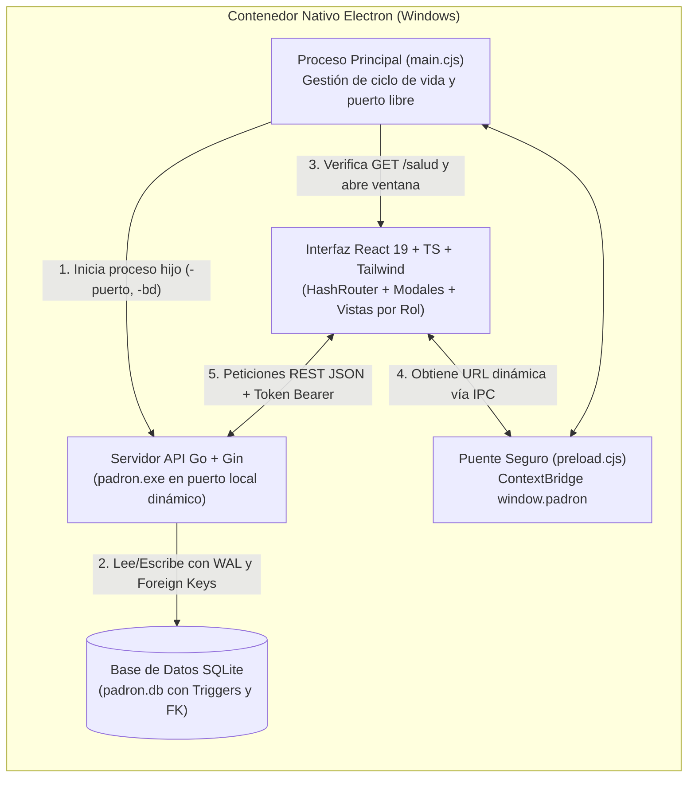
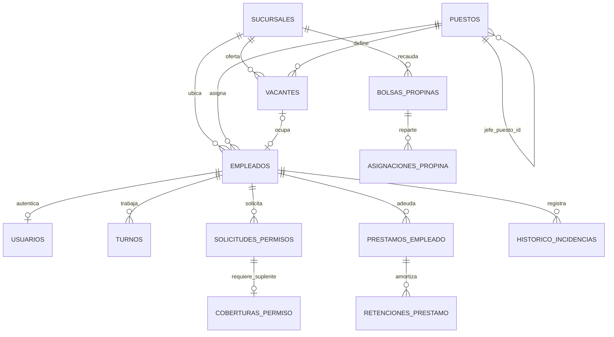
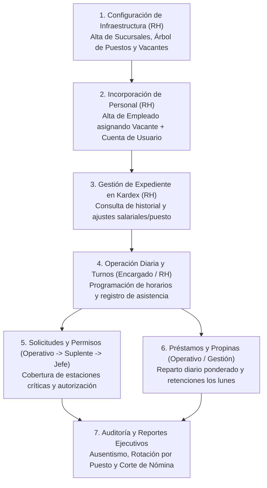

# Manual Técnico del Sistema y Flujo Normal de Operación — PADRÓN RH

Este documento constituye el **Manual Técnico Integral** y la **Guía del Flujo Normal de Operación** del sistema **PADRÓN — Recursos Humanos y Operación**, desarrollado para **Carnitas y Carne Asada PADRÓN**.

---

## Parte I: Manual Técnico del Programa

### 1. Arquitectura General del Sistema

El sistema opera bajo una arquitectura de **escritorio autónoma de tres capas** empaquetada en un único distribuible para Windows. No depende de servidores externos, motores de bases de datos instalados en el sistema operativo ni conexión a internet.



#### Componentes del Runtime
1. **Proceso Principal (`frontend/electron/main.cjs`):**
   - Garantiza que solo exista **una instancia abierta** (`requestSingleInstanceLock`) para evitar bloqueos de concurrencia en SQLite.
   - Determina la carpeta de datos (`PADRON-datos/padron.db`): junto al `.exe` en modo Portable o en `%APPDATA%\PADRON RH\` en modo Instalador.
   - Si el equipo es nuevo y no existe `padron.db`, copia la base de datos semilla incluida en `resources/backend/padron.db`.
   - Encuentra un puerto libre en `127.0.0.1` y ejecuta `padron.exe` en segundo plano sin ventana de consola (`windowsHide: true`).
   - Elimina la barra de menús de Chromium (`Menu.setApplicationMenu(null)`) y aplica el ícono institucional de PADRÓN (`icon.ico`).
2. **Servidor Backend (`main.go` -> `padron.exe`):**
   - Compilado en Go puro con el driver `modernc.org/sqlite` (sin dependencia de CGO ni DLLs externas).
   - Al arrancar ejecuta automáticamente `migrar(db)` y `datosIniciales(db)`, asegurando que todas las tablas, columnas, índices, triggers y catálogos base existan siempre.
3. **Aplicación Frontend (`frontend/src/`):**
   - Single Page Application (SPA) en React 19 y TypeScript que adapta dinámicamente el menú lateral (`Sidebar.tsx`) y las rutas (`RutaProtegida.tsx`) según el rol del usuario autenticado.

---

### 2. Modelo de Base de Datos (Esquema SQLite)

La base de datos se abre con llaves foráneas activas (`_pragma=foreign_keys(1)`) y tiempo de espera ante concurrencia (`_pragma=busy_timeout(5000)`).



#### Diccionario de Tablas

| Tabla | Descripción Técnica y Restricciones Clave |
| :--- | :--- |
| **`sucursales`** | Catálogo de unidades operativas (`id`, `nombre` único, `direccion`, `telefono`, `activo`). |
| **`puestos`** | Catálogo de cargos con auto-referencia jerárquica (`jefe_puesto_id REFERENCES puestos(id)`), `es_critico`, `requiere_suplente` y `factor_propina` (`CHECK >= 0`). |
| **`vacantes`** | Plazas de trabajo (`codigo` único ej. `VAC-001`, `titulo`, `puesto_id`, `sucursal_id`, `empleado_id`, `sueldo_ofertado_centavos`, `requisitos`, `estado` en `DISPONIBLE`, `CUBIERTA`, `PAUSADA`, `CANCELADA`). |
| **`empleados`** | Padrón de trabajadores (`numero_empleado` único, `nombres`, `apellido_paterno`, `apellido_materno`, `curp` único, `correo`, `telefono`, `fecha_ingreso`, `sueldo_semanal_centavos > 0`, `sucursal_id`, `puesto_id`, `vacante_id`, `activo`). |
| **`usuarios`** | Credenciales de acceso al sistema (`empleado_id` opcional para admin central, `nombre_usuario` único, `contrasena_hash` en bcrypt, `rol` en `RH_ADMIN`, `ENCARGADO`, `OPERATIVO`). |
| **`turnos`** | Jornadas laborales (`empleado_id`, `fecha`, `hora_inicio`, `hora_fin`, `estado` en `PROGRAMADO`, `TRABAJADO`, `FALTA`, `RETARDO`, `CANCELADO`, `horas_trabajadas`). Restricción `UNIQUE(empleado_id, fecha, hora_inicio)`. |
| **`solicitudes_permisos`** | Peticiones de ausencia (`empleado_id`, `tipo` en `VACACIONES`, `ENFERMEDAD`, `DESCANSO`, `PERMISO_EXTRAORDINARIO`, `fecha_inicio`, `fecha_fin`, `estado`, `requiere_cobertura`, `aprobado_por`, `observacion_dictamen`). |
| **`coberturas_permiso`** | Compromiso de suplencia (`solicitud_id` único, `suplente_empleado_id`, `estado` en `PENDIENTE`, `ACEPTADA`, `RECHAZADA`, `comentario`, `respondido_en`). |
| **`prestamos_empleado`** | Créditos internos (`empleado_id`, `monto_original_centavos`, `saldo_centavos`, `descuento_semanal_centavos`, `numero_semanas`, `estado` en `PENDIENTE`, `APROBADO`, `RECHAZADO`, `LIQUIDADO`, `CANCELADO`). |
| **`retenciones_prestamo`** | Amortizaciones semanales (`prestamo_id`, `semana_inicio`, `monto_centavos`, `saldo_posterior_centavos`). Restricción `UNIQUE(prestamo_id, semana_inicio)`. |
| **`bolsas_propinas`** | Fondo diario de propinas por sucursal (`sucursal_id`, `fecha`, `monto_centavos`, `estado`). Restricción `UNIQUE(sucursal_id, fecha)`. |
| **`asignaciones_propina`** | Desglose individual calculado (`bolsa_id`, `empleado_id`, `horas_ponderadas`, `monto_centavos`). |
| **`buzon_sugerencias`** | Reportes internos directos o anónimos (`empleado_id` nulo si `anonimo = 1`, `tipo`, `asunto`, `descripcion`, `prioridad`, `estado`, `respuesta`). |
| **`historico_incidencias`** | Bitácora perpetua del trabajador (`empleado_id`, `tipo`, `descripcion`, `fecha_evento`, `registrado_por`). **Protegida por los triggers `impedir_actualizar_historico` e `impedir_borrar_historico`.** |
| **`auditoria`** | Registro forense de operaciones administrativas (`usuario_id`, `accion`, `entidad`, `entidad_id`, `detalle`, `creado_en`). |

---

### 3. Seguridad, Tokens y Matriz de Permisos por Rol

1. **Almacenamiento de Contraseñas:** Ninguna contraseña se guarda en texto plano. Se utiliza `bcrypt.GenerateFromPassword` con costo estándar.
2. **Tokens Firmados (HMAC-SHA256):** Al iniciar sesión se emite un token con estructura `<payload_base64>.<firma_hmac_base64>` con vigencia de **8 horas** (`480 minutos`).
3. **Protección del Último Administrador:** El backend impide desactivar o cambiar de rol a la última cuenta activa con rol `RH_ADMIN` para evitar que el sistema quede inaccesible.

#### Matriz de Acceso por Rol

| Módulo / Acción | `OPERATIVO` | `ENCARGADO` (Jefe) | `RH_ADMIN` |
| :--- | :---: | :---: | :---: |
| Consultar su propio Dashboard, Turnos, Propinas y Perfil | Sí | Sí | Sí |
| Solicitar Permisos, Préstamos y enviar al Buzón | Sí | Sí | Sí |
| Aceptar / Rechazar ser Suplente de un compañero | Sí | Sí | Sí |
| **Dictaminar (Aprobar / Rechazar) Permisos de personal** | No | **Sí (Autorizador)** | Consulta / Admin |
| Programar Turnos y registrar Asistencia / Retardos / Faltas | No | Sí | Sí |
| Gestionar Bolsas de Propinas y Reportes Ejecutivos | No | Sí | Sí |
| **Alta de Empleados, Kardex de Usuario y edición controlada** | No | Consulta | **Sí** |
| **Alta y gestión de Sucursales, Puestos, Árbol y Vacantes** | No | No | **Sí** |
| **Administración de Cuentas de Usuario y Roles** | No | No | **Sí** |

---

### 4. Reglas de Negocio e Invariantes del Backend

1. **Campos Protegidos en el Kardex de Usuario:**
   - Tanto en la interfaz (`KardexEmpleadoView.tsx`) como en el endpoint `PATCH /api/v1/empleados/:id`, los campos **Nombre Completo (`nombres`, `apellido_paterno`, `apellido_materno`), CURP, Número de Nómina (`numero_empleado`), Fecha de Ingreso y Nombre de Usuario** son estrictamente inmutables tras el alta.
   - Si se modifica el sueldo o el puesto de un empleado en el Kardex, el backend inserta automáticamente un registro en `historico_incidencias` (`CAMBIO_SALARIAL` o `CAMBIO_PUESTO`) dejando trazabilidad permanente.
2. **Validación de Estaciones Críticas en Fin de Semana:**
   - La función `tocaFinDeSemana(inicio, fin)` evalúa día por día el rango solicitado.
   - Si el puesto del empleado tiene `es_critico = 1` y `requiere_suplente = 1`, y el permiso toca **sábado o domingo**:
     - Es obligatorio indicar `suplente_id`.
     - El suplente debe estar activo, pertenecer a la **misma sucursal** y tener el **mismo puesto**.
     - El suplente no puede tener otra ausencia aprobada o pendiente que se traslape en fechas.
     - La solicitud nace en estado `PENDIENTE_SUPLENTE` y **no puede ser aprobada** hasta que el suplente invoque `/cobertura/confirmar` con `aceptar: true`, momento en que pasa a `PENDIENTE_APROBACION`.
3. **Topes Financieros de Préstamos:**
   - **Monto máximo:** $\text{Monto} \le 2 \times \text{Sueldo Semanal}$.
   - **Descuento semanal individual:** $\lceil \text{Monto} / \text{Semanas} \rceil \le 35\% \text{ del Sueldo Semanal}$.
   - **Límite de endeudamiento acumulado al aprobar:** La suma de descuentos semanales de todos los préstamos en estado `APROBADO` con saldo pendiente más el nuevo préstamo no puede exceder el **40% del Sueldo Semanal**.
   - **Día de retención:** Solo se permite registrar descuentos nominales indicando una fecha `semana_inicio` que sea **Lunes** (`time.Monday`), impidiendo cobros duplicados en la misma semana.
4. **Fórmula de Reparto Exacto de Propinas:**
   - Para una sucursal y fecha, se obtienen todos los turnos con `estado = 'TRABAJADO'` y `horas_trabajadas > 0`.
   - Para cada participante $i$, se calcula su peso ponderado:
     $$P_i = \text{horas\_trabajadas}_i \times \text{factor\_propina}_i$$
   - La asignación base en centavos se calcula como:
     $$M_i = \left\lfloor \text{Bolsa}_{\text{centavos}} \times \frac{P_i}{\sum P_j} \right\rfloor$$
   - Los centavos residuales ($\text{Bolsa}_{\text{centavos}} - \sum M_i$) se suman al último participante para garantizar que el 100% de la bolsa se reparta sin perder ni inventar un solo centavo.

---

## Parte II: Flujo Normal de Operación del Programa

A continuación se detalla el flujo operativo estándar desde que la empresa configura el sistema hasta el cierre semanal de nómina y reportes.



---

### Paso 1: Configuración de Sucursales, Puestos y Vacantes (`RH_ADMIN`)

1. **Iniciar sesión** con la cuenta administradora (`admin` / `Cambiar123!`).
2. Ir al módulo **Recursos Humanos (`Empleados`)** en el menú lateral:
   - **Pestaña "Sucursales":** Dar clic en **Nueva Sucursal** para registrar las unidades de negocio (ej. *Matriz PADRÓN*, *Sucursal Norte*) con dirección y teléfono.
   - **Pestaña "Árbol Jerárquico de Puestos":** Visualizar la estructura organizacional interactiva. Para agregar un cargo, pulsar **Nuevo Puesto**, definir su nombre, indicar quién es su **Puesto Jefe Inmediato** (`jefe_puesto_id`), su factor de propinas (ej. `1.30` para Maestro Carnitero) y marcar si es **Estación Crítica con Suplente Obligatorio**.
   - **Pestaña "Vacantes y Plazas":** Pulsar **Nueva Vacante** para abrir las plazas autorizadas en cada sucursal (ej. código `VAC-008`, título *Parrillero Matutino*, puesto *Parrillero*, sucursal *Matriz*, sueldo ofertado). La vacante queda en estado `DISPONIBLE`.

---

### Paso 2: Alta de Colaboradores y Asignación de Plaza (`RH_ADMIN`)

1. En **Recursos Humanos -> Pestaña "Plantilla de Personal"**, hacer clic en **Nuevo Colaborador**.
2. En el modal de registro:
   - Seleccionar una **Vacante Disponible** del desplegable; el sistema autocompletará automáticamente la **Sucursal**, el **Puesto** y el **Sueldo Semanal** ofertado en esa plaza.
   - Capturar los datos de identidad: **Número de Nómina** (ej. `PAD-010`), **Nombres**, **Apellido Paterno**, **Apellido Materno**, **CURP** (18 caracteres), **Fecha de Ingreso**, correo y teléfono.
   - En la sección de acceso, definir su **Nombre de Usuario**, **Contraseña inicial** y **Rol** (`OPERATIVO`, `ENCARGADO` o `RH_ADMIN`).
3. Al guardar:
   - Se crea el expediente del trabajador.
   - La vacante seleccionada pasa automáticamente a estado `CUBIERTA` y queda vinculada al trabajador.
   - Se crea su cuenta de usuario para que pueda ingresar al sistema.

---

### Paso 3: Consulta y Mantenimiento del Kardex de Usuario (`RH_ADMIN`)

1. En **Recursos Humanos -> Pestaña "Kardex de Usuario"** (o haciendo clic en el botón **Kardex** de cualquier fila en la tabla de personal):
2. Se despliega el expediente integral del trabajador seleccionado:
   - **Indicadores superiores:** Días de antigüedad calculados desde su ingreso, saldo pendiente en préstamos, total de incidencias y permisos.
   - **Bloque de Identidad Protegida (Candado):** Muestra Nombre Completo, CURP, Número de Nómina, Fecha de Ingreso y Usuario de Acceso bloqueados en modo sólo lectura.
   - **Formulario de Datos Modificables:** Permite a RH cambiar al trabajador de Sucursal, ascenderlo de Puesto, asignarle otra Vacante, ajustar su Sueldo Semanal, actualizar su Teléfono/Correo o aplicar su baja lógica (`Activo / Inactivo`).
   - **Pestañas inferiores del Kardex:** Permiten revisar en un solo lugar todas las **Incidencias**, **Permisos** y **Préstamos** históricos de ese trabajador en específico.

---

### Paso 4: Flujo de Permisos, Suplencias y Autorización por Jefes

```mermaid
sequenceDiagram
    actor Op as Colaborador (Operativo)
    participantSys as Sistema PADRÓN
    actor Sup as Compañero Suplente
    actor Jefe as Jefe Directo (Encargado)

    Op->>participantSys: 1. Solicita Permiso (Sábado/Domingo en Puesto Crítico)
    participantSys-->>Op: Valida que Suplente sea activo, mismo puesto y sucursal
    participantSys->>Sup: 2. Estado: PENDIENTE_SUPLENTE
    Sup->>participantSys: 3. Confirma Cobertura (Aceptar = true)
    participantSys->>Jefe: 4. Estado cambia a: PENDIENTE_APROBACION
    Jefe->>participantSys: 5. Dictamina y Aprueba Solicitud
    participantSys-->>Op: 6. Estado final: APROBADA + Registro en Histórico
```

1. **Solicitud (`OPERATIVO`):** El trabajador entra al módulo **Permisos**, abre el pop-up **Solicitar Permiso**, elige el tipo (`DESCANSO`, `VACACIONES`, etc.), las fechas y el motivo. Si su puesto es crítico y abarca fin de semana, selecciona a su compañero suplente.
2. **Confirmación de Cobertura (`SUPLENTE`):** El compañero elegido ingresa con su cuenta al módulo **Permisos**, localiza la solicitud donde figura como suplente y pulsa **Aceptar Cobertura**.
3. **Autorización (`ENCARGADO`):** El jefe directo entra a la bandeja de **Permisos**, revisa que la cobertura ya fue confirmada y pulsa **Aprobar** (o **Rechazar** indicando el motivo en el modal).

---

### Paso 5: Flujo de Préstamos y Retenciones Semanales en Nómina

1. **Solicitud:** El empleado entra a **Préstamos -> Solicitar Préstamo**, ingresa el monto requerido y el plazo en semanas (1 a 52). La interfaz calcula en vivo el descuento semanal estimado y valida que no supere los topes (máximo 2 semanas de sueldo y abono $\le 35\%$).
2. **Aprobación:** El encargado o administrador revisa la solicitud pendiente y la aprueba. El sistema verifica que el endeudamiento total activo del trabajador no rebase el 40% de su sueldo semanal.
3. **Descuento en Nómina (Cada Lunes):**
   - Cada inicio de semana de nómina, desde la tarjeta del préstamo aprobado se pulsa **Registrar Retención**.
   - Se selecciona la fecha del **lunes** correspondiente.
   - El sistema descuenta la cuota semanal del saldo pendiente. Cuando el saldo llega a `$0.00`, el préstamo cambia automáticamente a estado `LIQUIDADO`.

---

### Paso 6: Registro y Reparto Ponderado de Propinas

1. Al cierre del día, el Encargado registra o verifica que los turnos del personal tengan estado `TRABAJADO` con sus horas correspondientes.
2. En el módulo **Propinas**, pulsa **Nueva Bolsa de Propinas**, selecciona la sucursal, la fecha del día y captura el monto total recaudado.
3. Pulsa **Calcular Asignaciones**: el sistema reparte automáticamente la bolsa multiplicando las horas trabajadas de cada colaborador por el `factor_propina` de su puesto (por ejemplo, dando mayor ponderación al Maestro Carnitero y Parrillero que a puestos de apoyo).
4. Cada trabajador puede consultar de inmediato cuánto le correspondió desde su vista personal de **Propinas**.

---

### Paso 7: Bitácora de Incidencias, Buzón y Reportes Ejecutivos

1. **Incidencias (`Incidencias`):** Cualquier retardo, falta o cambio salarial queda asentado de forma automática o manual en la bitácora inmutable del trabajador.
2. **Buzón (`Solicitudes`):** Cualquier colaborador puede enviar sugerencias o reportar incidentes de mantenimiento/seguridad activando opcionalmente la casilla **Enviar de forma anónima**. Los encargados dan seguimiento cambiando el estado a `EN_REVISION`, `ATENDIDO` o `CERRADO` con su respuesta oficial.
3. **Reportes (`Reportes`):**
   - **Ausentismo:** Muestra por rango de fechas los turnos programados, faltas totales, retardos y faltas en fin de semana (sábado/domingo) por empleado.
   - **Rotación por Puesto:** Muestra el histórico de empleados, activos actuales, bajas y cambios de puesto por cada cargo del organigrama.
   - **Retenciones de Nómina:** Genera el listado exacto de descuentos de préstamos aplicados en una semana específica para el cierre contable de nómina.

---

## Parte III: Mantenimiento y Respaldo en Producción

- **Respaldo de Información (Backup):**
  Toda la información del sistema reside en el archivo `padron.db` ubicado dentro de la carpeta `PADRON-datos`. Para realizar un respaldo completo, basta con **cerrar la aplicación PADRÓN RH** y copiar el archivo `padron.db` a una ubicación segura o almacenamiento externo.
- **Restauración o Migración de Equipo:**
  Para migrar toda la operación a una computadora nueva, instala o copia `PADRON RH Portable.exe` en el nuevo equipo y coloca tu archivo `padron.db` respaldado dentro de la carpeta `PADRON-datos/`. Al abrir el programa, toda la plantilla, Kardex, vacantes e históricos estarán intactos.
